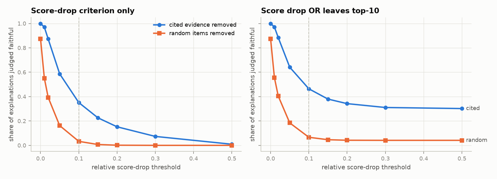
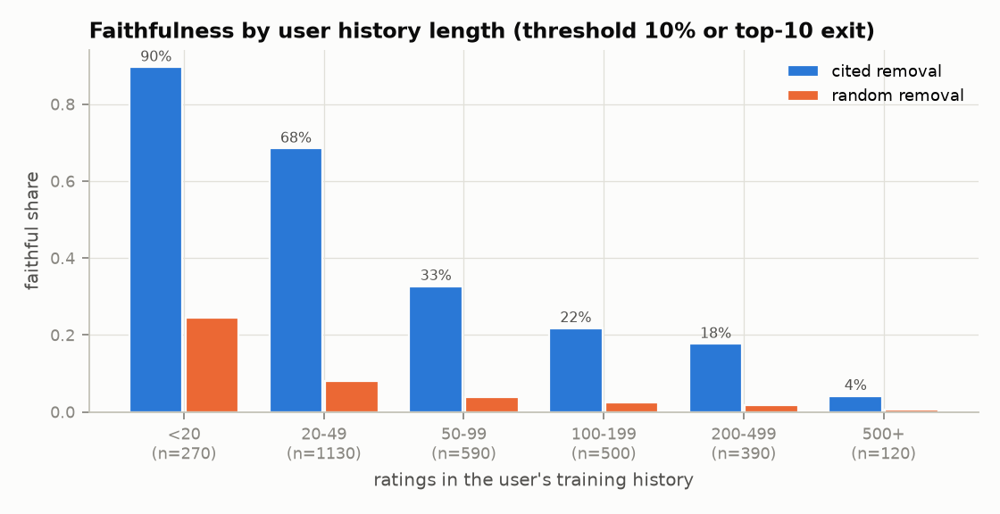
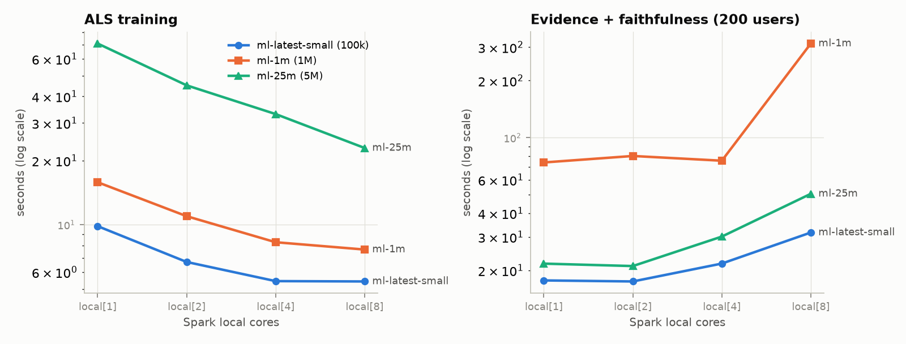
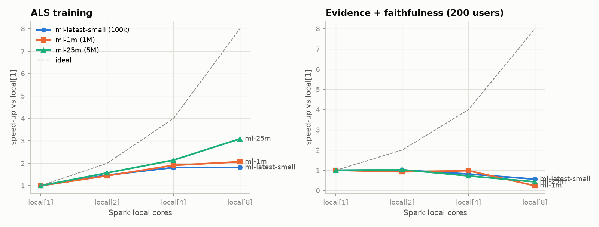
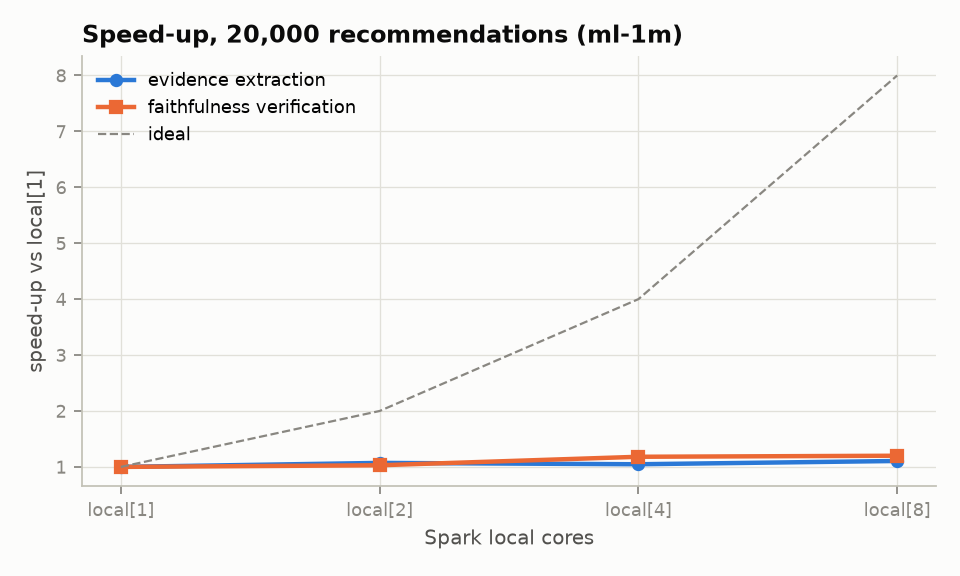

# i-recs results (ml-latest-small)

Generated by `python -m scripts.make_report`. All numbers come from the stage outputs in `outputs/ml-latest-small/`.

## Data and split

100,836 ratings after cleaning; per-user temporal split: 80,419 train / 18,715 test ratings, 610 users, 8,230 items.

## M1 Recommender (test set, unseen items only)

| model | precision@10 | recall@10 | mrr@10 | ndcg@10 |
|---|---|---|---|---|
| ALS-implicit | 0.0731 | 0.07563 | 0.1804 | 0.0908 |
| Popularity | 0.05821 | 0.05035 | 0.165 | 0.07592 |

Chosen by validation NDCG@10 on a time-based split of train: implicit ALS rank=20, regParam=0.05, alpha=1.0. Rating prediction (explicit ALS, rank=20, regParam=0.2): **test RMSE 0.921**.

## M2 Evidence extraction

3,000 recommendations for 300 sampled users; mean history 127 ratings; 100% have positive-influence evidence. Top evidence item = 5.5% of the score on average. Runtime 5.6s (fold-in, no retraining).

## M3/M4 Explanations and grounding

| writer | n | grounded_rate | mean_words | mean_flesch |
|---|---|---|---|---|
| groq:openai/gpt-oss-120b | 50 | 1 | 33.78 | 66.64 |
| template | 2,950 | 1 | 40.96 | 72.71 |

Stress test on 500 explanations: clean false-positive rate 0.0%; detection recall per injected hallucination type: other_title 100%, wrong_year 100%, wrong_genre 100%, outside_reason 100%, wrong_rating 100%.

Example LLM explanations (evidence-only prompt, all passed the grounding check):

> Because you rated American Beauty (1999) 4.0 and The Sixth Sense (1999) 4.5, and removing those ratings lowers the model’s score the most, it recommends The Matrix (1999).

> Because you rated Clear and Present Danger (1994) 5.0 (Action, Crime, Thriller) and True Lies (1994) 4.0 (Action, Thriller), these past ratings led the model to recommend Batman (1989).

> Because you rated Little Women (1994) 4.5 and Four Weddings and a Funeral (1994) 3.5 (sharing Comedy and Romance), those past ratings led the model to recommend Pretty Woman (1990).

## M5 Faithfulness (core result)

Faithful = removing the cited items (jointly, fold-in) lowers the score by >= 10% or pushes the item out of the top-10. 3,000 explanations, 9,000 random-removal trials.

| condition | faithful share | mean rel. drop | median rel. drop | left top-10 |
|---|---|---|---|---|
| cited evidence removed | 0.464 | 0.1045 | 0.06307 | 0.302 |
| random items removed (baseline) | 0.06633 | 0.02359 | 0.01251 | 0.04122 |

Paired: cited removal beats the mean random removal for **100.0%** of explanations (one-sided Wilcoxon p = 0). Fold-in ranks match the ALS ranking for 100% of recommendations.

| history | n | cited faithful | random faithful |
|---|---|---|---|
| <20 | 270 | 0.8963 | 0.2444 |
| 20-49 | 1,130 | 0.685 | 0.07994 |
| 50-99 | 590 | 0.3271 | 0.03842 |
| 100-199 | 500 | 0.218 | 0.02467 |
| 200-499 | 390 | 0.1769 | 0.01795 |
| 500+ | 120 | 0.04167 | 0.005556 |

Reading: a 2-item explanation is usually faithful for users with short histories and rarely for heavy users, whose recommendations are spread over hundreds of past ratings. Cited items beat random items in every bucket.

## M6 Utility (offline proxy)

Label: recommended movie rated >= 4.0 in the user's test period (217 of 3000, base rate 0.072). Logistic regression (Spark MLlib), 5 user-grouped splits.

| features | ROC-AUC | ROC-AUC sd | PR-AUC |
|---|---|---|---|
| base | 0.5899 | 0.03922 | 0.1078 |
| base+expl | 0.638 | 0.04398 | 0.1394 |
| expl_only | 0.6115 | 0.03216 | 0.1162 |

Paired gain of explanation features: ROC-AUC +0.048, improved in 5/5 splits. Within history-size strata the faithful flag alone does not raise acceptance; the gain comes mainly from the evidence content (the user's ratings of the cited items). Observational proxy, not a causal user study.

## M7 Scalability (single machine, Spark local mode)

| label | ALS fit local[1] (s) | ALS fit local[2] (s) | ALS fit local[4] (s) | ALS fit local[8] (s) |
|---|---|---|---|---|
| ml-1m (1M) | 15.8 | 11 | 8.3 | 7.6 |
| ml-25m (5M) | 70.8 | 45.1 | 33.1 | 22.9 |
| ml-latest-small (100k) | 9.8 | 6.7 | 5.4 | 5.4 |

| label | evid+verify local[1] (s) | evid+verify local[2] (s) | evid+verify local[4] (s) | evid+verify local[8] (s) |
|---|---|---|---|---|
| ml-1m (1M) | 74.1 | 80.1 | 75.6 | 313.5 |
| ml-25m (5M) | 21.7 | 21.1 | 30.1 | 50.6 |
| ml-latest-small (100k) | 17.7 | 17.5 | 21.7 | 31.6 |

Evidence and verification touch only the 200 sampled users, so with 2 partitions per core most of their time is Spark task scheduling and, on Windows, starting a fresh Python worker per task (no fork-based worker daemon). The run below uses 2,000 users and 1 partition per core to measure the compute itself.

### Evidence + faithfulness scaling (ml-1m, 2000 users)

| cores | n_recs | t_evidence | t_verify | verify_rows | evidence speed-up | verify speed-up |
|---|---|---|---|---|---|---|
| 1 | 20,000 | 46.71 | 137 | 80,000 | 1 | 1 |
| 2 | 20,000 | 43.59 | 133.1 | 80,000 | 1.07 | 1.03 |
| 4 | 20,000 | 44.59 | 116 | 80,000 | 1.05 | 1.18 |
| 8 | 20,000 | 42.23 | 114.2 | 80,000 | 1.11 | 1.2 |

Reading: ALS training is the distributed workload and scales with data and cores (ml-25m (5M): 71s on local[1] -> 23s on local[8], 3.1x). Evidence and verification cost depends on the number of explained recommendations and the sampled users' history lengths, not on total dataset size (one batched k x k solve per user), so it stays at tens of seconds even on 5M ratings. On a single Windows laptop their parallel speed-up is small because per-task Python worker start-up dominates; the occasional large outlier (e.g. ml-1m local[8] verification) is most likely worker start-up contention rather than compute. A multi-node cluster (EMR/Dataproc) with fork-based Python workers is expected to remove most of this overhead.

## Summary

- ALS-implicit beats popularity on every top-10 metric (NDCG@10 0.091 vs 0.076).
- Evidence-only explanations are grounded (groq:openai/gpt-oss-120b: 100% of 50, template: 100% of 2,950); on the stress test the checker's lowest per-type detection recall is 100%, with a 0% false-positive rate.
- **46.4%** of explanations are faithful (removing the cited items drops the score as claimed), vs 6.6% for random removals of the same size; cited beats random for 100% of explanations. Faithfulness falls with history length: a 2-item explanation cannot carry a heavy user's recommendation.
- Explanation features add ROC-AUC +0.048 to an offline acceptance proxy (observational, not causal).
- The whole pipeline runs on Spark; ALS training scales with cores and evidence/verification cost does not grow with total dataset size.
